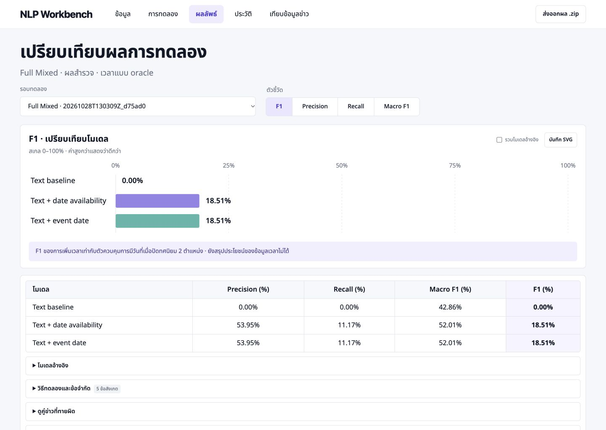

# Company News NLP Workbench

เว็บสำหรับทดลอง NLP กับ **คู่ข้อความจากข่าวบริษัท** นำเข้า Excel/CSV แก้โค้ด Python รันเปรียบเทียบโมเดล และเก็บหลักฐานของแต่ละรอบไว้ใช้ในรายงานวิจัย

โครงงานนี้กำลังศึกษาว่า **การเพิ่มข้อมูลบทบาทผู้ซื้อและบริษัทเป้าหมาย ช่วยบอกได้ไหมว่าข่าวสองชิ้นกล่าวถึงเหตุการณ์เดียวกัน** โดยใช้การทดลองเล็ก ๆ ที่ตรวจสอบและทำซ้ำได้ก่อน

> **สถานะปัจจุบัน:** ทดลอง Text และ Text + roles ได้แล้วด้วยข้อมูลบทบาทที่ AI ช่วยเตรียมจากข่าวฉบับเต็ม **ยังรอคนตรวจ** และผล Pilot เล็กยังไม่ยืนยันว่า improvement ใช้ได้ทั่วไป



## ถ้าเพิ่งเข้ามาใน repo นี้

1. ติดตั้งและเปิดเว็บตามขั้นตอนด้านล่าง
2. เลือก **Pilot A + บทบาทจาก AI → โหลดข้อมูล → รันและบันทึกการทดลอง** เพื่อดู Text เทียบ Text + roles
3. อ่าน [วิธีการทดลอง](METHODS_TH.md) และ [แผนงานสำหรับทีม](docs/TEAM_HANDOFF_TH.md) ก่อนแก้โมเดล
4. อ่าน [คู่มือฉบับละเอียด](README_TH.md) เมื่อต้องการนำเข้าไฟล์หรือเขียนโค้ดเอง

## ติดตั้งบนเครื่องใหม่

ต้องมี **Python 3.12**, Git และอินเทอร์เน็ตสำหรับติดตั้ง dependencies ครั้งแรก การทดลองตั้งต้นใช้ CPU และไม่ต้องมี API key

```sh
git clone https://github.com/Micosz/company-news-nlp-workbench.git
cd company-news-nlp-workbench
```

Repo เป็น public จึงอ่านและ clone ไปทดลองได้ทันที หากต้องการ push เข้า repo โดยตรง เจ้าของ repo ต้องเพิ่มสิทธิ์ collaborator ก่อน และไม่ใส่ token ลงไฟล์ของโครงการ

### macOS / Linux

```sh
python3.12 -m venv .venv
.venv/bin/python -m pip install -r requirements.txt
.venv/bin/python server.py --open-browser
```

หากคำสั่ง `python3` ของเครื่องเป็น 3.12 อยู่แล้ว ใช้ `python3` แทน `python3.12` ได้ หลังติดตั้งบน macOS สามารถดับเบิลคลิก `Start_Workbench.command` ในครั้งถัดไปได้

### Windows PowerShell

```powershell
py -3.12 -m venv .venv
.venv\Scripts\python.exe -m pip install -r requirements.txt
.venv\Scripts\python.exe server.py --open-browser
```

เว็บเปิดที่ **http://127.0.0.1:8765** และต้องเปิด Terminal ค้างไว้ หยุดด้วย `Ctrl+C` ขณะไม่มีการทดลองรันอยู่ ระบบได้รับการตรวจบน macOS นี้ ส่วน Windows มีคำสั่งติดตั้งให้ แต่ยังไม่ได้ทดสอบครบทุกฟังก์ชัน

## หน้าตาใหม่: ดูผลก่อน แล้วค่อยเปิดรายละเอียด

- **ผลลัพธ์** เปิดรอบล่าสุดที่รันสำเร็จให้อัตโนมัติ หรือเลือกรอบอื่นจากช่องด้านบน โดยไม่รันโมเดลใหม่
- เปลี่ยนแท็บ **F1 / Precision / Recall / Macro F1** เพื่อดูกราฟสเกล 0–100% และคอลัมน์คะแนนที่เลือก
- กราฟเริ่มจากโมเดลหลัก เปิด **รวมโมเดลอ้างอิง** เพื่อดู Majority / Cosine / Time only เพิ่มได้
- เปิดแถวด้านล่างเพื่อดูข้อจำกัด คู่ข่าวที่ทายผิด confusion matrix, B³ และผลแยกตามข้อมูลเวลา ตัวเลขทั้งหมดอ่านจากผลรันจริง ไม่ใส่ค่าจากภาพออกแบบ
- เมนู **ข้อมูล → การทดลอง** ใช้โหลดข้อมูลและรันงาน ส่วนโค้ด Python อยู่ในแถว **ดูหรือแก้ไขโค้ด Python**
- **ประวัติ** ยังเปิดผลย้อนหลังและลบรายรอบ/ทั้งหมดได้; **เทียบข้อมูลข่าว** เป็นต้นแบบกรอกข้อมูลเปรียบเทียบด้วยกฎเดิม
- กด **ส่งออกผล .zip** สำหรับหลักฐานของรอบที่กำลังเปิด หรือ **บันทึก SVG** สำหรับกราฟ

ภาพตัวอย่างเป็นผลสำรวจ Full Mixed ที่ใช้เวลาแบบ oracle ไม่ใช่หลักฐานว่า improvement สำเร็จ หรือผลของ CohTP เต็มระบบ ฟอนต์ Noto Sans Thai เก็บในโปรเจกต์เพื่อใช้ได้โดยไม่ต้องเชื่อมต่อเว็บฟอนต์

## ที่มาของ Dataset

เราใช้และสำรวจข้อมูลจากหลายแหล่ง โดยการทดลอง Pilot เดิมใช้ข้อมูลต้นทางเพียง **1 ชุด คือ ECB+** ส่วนชุดเวลาที่เตรียมเพิ่มเชื่อมป้ายของ ECB+ กับ Event StoryLine:

| ชุดข้อมูล | ใช้ทำอะไรในโครงการ | สถานะปัจจุบัน |
|---|---|---|
| [ECB+](https://github.com/cltl/ecbPlus) · [paper ของ dataset](https://aclanthology.org/L14-1646/) | ข่าวและป้ายกำกับว่า event mentions กล่าวถึงเหตุการณ์เดียวกันหรือไม่ | **ใช้จริง** ใน Pilot A/B และชุด Full ECB+ |
| [TKGQA](https://osf.io/xqwa4/) · [paper ของ dataset](https://doi.org/10.3390/data8030061) | ข่าวการเงินเกี่ยวกับ M&A พร้อมข้อมูลเหตุการณ์และเวลา สำหรับสำรวจต่อ | ดาวน์โหลดและเตรียมแยกไว้แล้ว แต่ **ยังไม่ได้ใช้เป็นเฉลย event coreference** ในผลทดลองปัจจุบัน |
| [Event StoryLine v1.0](https://github.com/tommasoc80/EventStoryLine) · [paper](https://aclanthology.org/W17-2711/) | ป้ายความสัมพันธ์ระหว่างข้อความเวลากับเหตุการณ์ในบางข่าวของ ECB+ | **เชื่อมกับ ECB+ แล้ว** เป็นชุดทดลองเวลา 4,732 คู่ใน 21 หัวข้อ ไม่รวม Pilot M&A; ป้ายเวลาเป็น oracle ไม่ใช่ผลจากตัวดึงเวลา |
| [CDEC-WN](https://github.com/adithya7/cdec-wikinews) · [paper](https://aclanthology.org/2021.conll-1.39/) | ข่าวภัยพิบัติ/อุบัติเหตุพร้อมป้ายเชื่อมเหตุการณ์ข้ามข่าว | ดาวน์โหลดและตรวจแล้ว: release มี **4,282 คู่บวกเท่านั้น** แยก full/partial; ยังไม่รวมเป็นชุด train/test แบบมีคู่ลบ |
| [MAVEN-ERE](https://github.com/THU-KEG/MAVEN-ERE) · [paper](https://aclanthology.org/2022.emnlp-main.60/) | เหตุการณ์ทั่วไปและความสัมพันธ์เวลา สำหรับศึกษาเทคนิคที่ CohTP ใช้ | ศึกษาแหล่งต้นฉบับแล้ว **ยังไม่ได้ดาวน์โหลดหรือรวม**; ความสัมพันธ์เป็นภายในเอกสาร Wikipedia และเฉลย test ถูกซ่อน |

Pilot เลือกจาก ECB+ จำนวน 42 ข้อความจาก 42 ข่าว ครอบคลุม 4 เหตุการณ์ แล้วสร้าง 424 คู่โดยใช้ป้ายเหตุการณ์จาก ECB+ เดิม ส่วน Pilot A และ B เป็นการสลับ train/test ของข้อมูลชุดเดียวกัน ไม่ใช่คนละ dataset

**buyer และ target ไม่ใช่ป้ายที่ผู้สร้าง ECB+ ให้มา:** ทีมใช้ AI ช่วยอ่านข่าวฉบับเต็มแล้วเตรียมบทบาทเพิ่มเพื่อทดลอง โดยยังรอคนตรวจ จึงไม่ใช่ human gold หรือ oracle ชุด Pilot ข้อความสั้นอาจไม่ได้มีบริบทเดียวกับข่าวเต็มที่ใช้เตรียมบทบาท และคะแนนของชุดเล็กยังสรุปผลทั่วไปไม่ได้

ดูรายละเอียดที่มา การแบ่งข้อมูล และข้อจำกัดได้ใน [DATA_SOURCES_TH.md](docs/DATA_SOURCES_TH.md) และ [คู่มือชุดบทบาท AI](docs/PILOT_AI_ROLES_TH.md) ส่วน CohTP เป็น paper หลักที่ใช้ประกอบแนวคิด ไม่ใช่ dataset เพิ่มอีกชุด

**ชุดทดลองเวลาที่เตรียมเพิ่ม:** ECB+ และ Event StoryLine อ้างถึงข่าวเดียวกันบางส่วน ไม่ใช่สองชุดอิสระ เราเชื่อมเฉพาะ event token spans ที่ตรวจตรงกับต้นฉบับ และเก็บคู่ที่ทั้งสองฝั่งมีป้ายวันแบบระบุวันชัดเจนไว้ใน `local_data/ecb_story_time_v1/ecb_story_pairs.csv` บนเครื่องผู้พัฒนา ชุดนี้มี train/dev/test 2,850/880/1,002 คู่ใน 16/3/2 หัวข้อตามลำดับ การแบ่งเป็นของโครงการและ test เคยถูกสำรวจแล้ว ดูวิธีสร้างและข้อจำกัดใน [TEMPORAL_DATA_TH.md](docs/TEMPORAL_DATA_TH.md)

### ให้เพื่อนเตรียมและใช้ชุดเวลา

หลังติดตั้ง Python และ dependencies ตามด้านบนแล้ว ให้เตรียมข้อมูล **ครั้งเดียว** ด้วยคำสั่งนี้ในโฟลเดอร์โปรเจกต์ (ต้องเชื่อมต่ออินเทอร์เน็ต):

```sh
.venv/bin/python scripts/setup_temporal_dataset.py
```

Windows PowerShell ใช้ `.venv\Scripts\python.exe scripts/setup_temporal_dataset.py` สคริปต์ดาวน์โหลด ECB+ และ Event StoryLine จากแหล่งต้นฉบับ ตรวจ SHA-256 และสร้าง `local_data/ecb_story_time/` ในเครื่อง โดยไม่ดาวน์โหลด TKGQA หรือเขียนทับชุดที่มีอยู่ หากดาวน์โหลดไม่ได้โปรดดู [คู่มือและแหล่งต้นฉบับ](docs/TEMPORAL_DATA_TH.md)

เปิดเว็บ เลือก **ECB+ + Event StoryLine · 4,732 คู่ที่มีวันกำกับ** แล้วกด **โหลดข้อมูล** เว็บจะตั้งที่มาเวลาเป็น **ป้ายกำกับจากชุดข้อมูล (oracle)** ให้อัตโนมัติ จากนั้นกดรันเพื่อเทียบ Text baseline, Time only และ Text + time ในรอบเดียวกัน วันที่ตรง/ต่างเป็น feature ไม่ใช่กฎเฉลย โมเดลได้รับวันจาก annotation ที่รู้ไว้แล้ว ไม่ได้วัดการดึงเวลาจากข่าว ชุดนี้เป็น subset ไม่ใช่ Full 104,840 คู่ทั้งหมด และไม่รวม Pilot M&A

**ข้อจำกัดของ split เดิม:** test 1,002 คู่เป็นวันเดียวกันทั้งหมด (ต่างวัน 0 คู่) จึงไม่สามารถประเมินว่าระบบแยกกรณีวันเดียวกันและต่างวันใน test ได้ดีเพียงใด คะแนนเดิมไม่เพียงพอที่จะสรุปผลของข้อมูลวัน

มีตัวเลือก **Event StoryLine · แบ่งหัวข้อใหม่เพื่อสำรวจ** ใช้กฎสุ่มหัวข้อแบบคงที่ seed `20261028`, train/dev/test 14/3/4 หัวข้อ โดยไม่ใช้ label หรือคะแนนในการกำหนดกลุ่ม และตรวจการรั่วของเอกสาร/กลุ่ม/ข้อความ ตัวเลือกนี้มี train 2,678, dev 718, test 1,336 คู่; test มีวันเดียวกัน 1,241 และต่างวัน 95 คู่ ข้อมูลและ split ก่อนหน้าเคยถูกดูแล้ว จึงเป็นการสำรวจเพิ่มเติม ไม่ใช่ test อิสระที่ไม่เคยเห็น

การตั้งค่า threshold เลือกได้ระหว่าง **คงที่ 0.5** กับ **เลือกด้วย F1 จาก dev**: แต่ละโมเดลเลือก threshold จาก dev ที่มีทั้งสอง label โดยไม่ใช้ test labels ในการเลือก; majority ยังคงเป็น reference เดิม และเมื่อไม่มี dev ที่เหมาะสม ระบบจะแจ้งแทนการเลือกจาก test ข้อมูล dev ไม่ถูกใช้ฝึก vectorizer หรือ classifier ระบุ threshold ของแต่ละโมเดลเมื่อรายงานผล

หรือเลือก **Full ECB+ + เวลาเท่าที่มี · 104,840 คู่ (Mixed)** เพื่อเก็บ Full ทุกคู่และเติมวันจาก Event StoryLine เฉพาะ mention ที่เชื่อมกับ annotation ได้: วันครบทั้งคู่ 4,732 คู่, มีวันฝั่งเดียว 15,738 คู่, ไม่มีวันทั้งสองฝั่ง 84,370 คู่ วันขาดเป็น unknown ไม่ใช่วันที่สมมติ ป้ายและ split เดิมไม่เปลี่ยน เว็บแสดงผลแยกตามจำนวนวันที่มีใน test; ภายในแต่ละกลุ่มเปรียบเทียบสองโมเดลบนคู่เดียวกัน ดูรายละเอียดและข้อจำกัดใน [TEMPORAL_DATA_TH.md](docs/TEMPORAL_DATA_TH.md)

ถ้าเคยใช้เวอร์ชันเดิมที่สร้างเฉพาะชุด 4,732 คู่ ให้ `git pull` แล้วรันคำสั่ง `setup_temporal_dataset.py` ข้างบนอีกครั้ง ระบบจะตรวจไฟล์เดิมและสร้างไฟล์ mixed เพิ่ม ไม่เขียนทับผลเดิม

## เว็บทำอะไรได้แล้ว

- โหลดชุด Pilot A/B ที่แนบมา หรือนำเข้า `.xlsx` / `.csv` แล้วเลือกคอลัมน์
- ตรวจป้ายกำกับ คู่ซ้ำ และการรั่วข้าม train/test ของเอกสาร กลุ่ม และข้อความตรงกัน
- แก้ Python ในเว็บ นำเข้าไฟล์ `.py` หรือดาวน์โหลดโค้ดออกไป
- รัน Majority reference, Cosine reference, Text baseline และ Text + roles เมื่อมีข้อมูลบทบาท
- ดู Precision, Recall, F1, Macro F1 และ TP/FP/FN/TN พร้อมคู่ที่ทำนายผิด
- ดูกราฟแท่งเปรียบเทียบคะแนนและ confusion matrix พร้อมตัวเลขจากผลรันจริง เลือกคะแนน/โมเดลและดาวน์โหลด SVG ไปใช้ในรายงานได้
- ดาวน์โหลดแบบฟอร์ม annotation 42 mentions และนำกลับเข้าเว็บเพื่อสร้างคู่ Pilot A/B พร้อมตรวจหลักฐาน
- จัดกลุ่มด้วย connected components และวัด B³ เมื่อ test ของ Pilot มีคู่ครบทุกคู่; ชุด Full ที่สุ่มคู่ลบจะข้าม
- ทดลองเปรียบเทียบข่าวซื้อกิจการหรือปันผลที่ผู้ใช้กรอกเอง ตามวัน เวลา สถานะ ความแน่นอน และมูลค่า พร้อมตัวอย่างสมมติ ปรับเกณฑ์คลาดเคลื่อนได้และยังไม่แปลงสกุลเงิน เป็น rule-based demo ไม่ใช่ NLI การสกัดข่าวอัตโนมัติ หรือการยืนยันข้อเท็จจริง ดูเงื่อนไขใน [คู่มือ](README_TH.md#ต้นแบบเปรียบเทียบข้อมูลข่าว)
- เก็บข้อมูล โค้ด การตั้งค่า seed พารามิเตอร์ที่เรียนรู้ เวอร์ชัน dependencies และผลทำนายแยกต่อรอบ
- ดาวน์โหลดหลักฐานของแต่ละรอบเป็น ZIP
- ลบประวัติการทดลองทีละรอบหรือทั้งหมดจากสมุดบันทึก โดยต้องยืนยันก่อนลบ ระบบลบไฟล์ที่บันทึกในรอบนั้นรวมข้อมูล โค้ด และผลลัพธ์อย่างถาวร แต่ไม่ลบ dataset ต้นทางใน `local_data` หรือโค้ดโปรเจกต์; หากมีรอบที่กำลังรัน ต้องรอให้เสร็จก่อน

**โค้ด Python ที่วางจะรันด้วยสิทธิ์ผู้ใช้บนเครื่องจริง** ใช้เฉพาะโค้ดที่ทีมตรวจแล้ว ตัวเว็บเป็นเครื่องมือสำหรับคนเดียวบน localhost ไม่ควรนำขึ้นโฮสต์สาธารณะตามโค้ดปัจจุบัน

## อัลกอริทึมที่ทดลอง

```text
คู่ข้อความจากข่าว A / B
        ↓
HTML unescape → Unicode NFC → whitespace normalization
        ↓
TF-IDF word 1–2 grams (fit เฉพาะ train)
        ↓
Cosine similarity
        ├── Text baseline: cosine แบ่งช่วงจาก train → Categorical Naive Bayes
        └── Text + roles: cosine แบ่งช่วง + role categories → Categorical Naive Bayes
        ↓
วัดกับ labels ของ test ที่เก็บไว้ภายนอกฟังก์ชันโมเดล
```

การเปรียบเทียบส่วนเพิ่มจะใช้ **Text baseline vs Text + roles** บนข้อมูล split ตัวจำแนก และ hyperparameters เดียวกัน มี 3 role categories ได้แก่ buyer_relation, target_relation และ role_reversed โดย unknown แยกจาก mismatch อ่านนิยามและสูตรวัดผลใน [METHODS_TH.md](METHODS_TH.md)

CohTP เป็นงานที่ใช้ประกอบการตั้งโจทย์ โค้ดใน repo นี้เป็น baseline/ablation ที่เราเขียนเอง ยังไม่มีการทำ NLI temporal graph, GNN หรือวัดผล CoNLL clustering แบบเต็มระบบ

## ข้อมูลที่แนบมา

| ชุด | เนื้อหา | การแบ่ง |
|---|---|---|
| Pilot A | 42 ข่าว / 4 focal acquisition events / 424 คู่ | train AMD 253 คู่ → test HP 171 คู่ |
| Pilot B | ข้อมูลเดียวกัน สลับทิศ | train HP 171 คู่ → test AMD 253 คู่ |
| Full ECB+ (optional) | 982 ข่าวหลายโดเมน / 104,840 คู่ที่เตรียมไว้ | custom topic split; ใช้ package แยก |

Pilot พร้อมใช้หลัง clone: เลือกชุด **+ บทบาทจาก AI** เพื่อโหลด buyer/target ที่เตรียมไว้ครบทั้ง 42 ข้อความ ระบบตั้งที่มาบทบาทเป็น “โมเดลทำนาย” ให้อัตโนมัติ เพราะ AI ช่วยอ่านข่าวและคนยังไม่ได้ตรวจ ข้อมูลนี้เป็นข้อมูลทดลองเบื้องต้น ไม่ใช่ oracle หรือผลวัดความสามารถการสกัดบทบาท ข้อมูล full และผลรันดิบไม่ได้อยู่ใน Git วิธีเตรียม full และที่มาของข้อมูลอยู่ใน [DATA_SOURCES_TH.md](docs/DATA_SOURCES_TH.md)

บทบาทชุดนี้อาศัยข่าวฉบับเต็ม แต่ชุด Pilot ที่เว็บโหลดใช้ข้อความสั้นเดิม จึงมีข้อมูลบางส่วนที่บทบาทรู้แต่ข้อความสั้นไม่ระบุ และความตรงของบริษัทอาจเป็นทางลัดในชุดเล็กนี้ ดูวิธีทำซ้ำและข้อจำกัดใน [คู่มือชุดบทบาท AI](docs/PILOT_AI_ROLES_TH.md)

Excel เริ่มต้นอยู่ที่ [data/pilot_fold_A_roles_blank.xlsx](data/pilot_fold_A_roles_blank.xlsx) หรือดาวน์โหลดจากเว็บ ช่อง buyer/target ยังว่างโดยตั้งใจ

คอลัมน์บังคับ: `pair_id`, `text_a`, `text_b`, `label`, `split`, `doc_a`, `doc_b`, `group_id` — `label=1` คือเหตุการณ์เดียวกัน และ `label=0` คือคนละเหตุการณ์ รายละเอียด mapping และ roles อยู่ใน [คู่มือ](README_TH.md#นำเข้า-excel--csv)

## ผลตรวจระบบ Naive Bayes เบื้องต้น

| ชุด | Text baseline pairwise F1 | สิ่งที่ตรวจพบ |
|---|---:|---|
| Pilot A | 65.50% | B³ F1 69.68%; predicted 1 cluster จาก gold 2 clusters |
| Full ECB+ | 0.00% | ทำนาย test ทั้ง 18,588 คู่เป็น class 0 จึงไม่พบ class 1; B³ ถูกข้ามเพราะคู่ไม่ครบ |

ผลเหล่านี้เป็น **การตรวจระบบและสำรวจเบื้องต้น** ไม่ใช่ผล improvement: บทบาท AI ที่เพิ่มภายหลังยังรอคนตรวจ และ Full เป็น mixed-domain ไม่ใช่ held-out M&A ใหม่ รายละเอียดและ hashes ของผลเดิมอยู่ใน [docs/INITIAL_RESULTS_NB.json](docs/INITIAL_RESULTS_NB.json)

## ผลเดิมที่มีหลักฐานแล้ว (Logistic Regression รุ่นก่อน)

| การทดลอง | Text baseline F1 | Macro F1 | หมายเหตุ |
|---|---:|---:|---|
| Pilot A | 0.6486 | 0.4993 | train AMD → test HP |
| Pilot B | 0.6291 | 0.5401 | train HP → test AMD |

ค่าในตารางเป็นผล Logistic Regression รุ่นก่อน ไม่ใช่ผล Naive Bayes รุ่นปัจจุบัน และ **ยังไม่ใช่ผล improvement** positive-class F1 ยังต่ำกว่าการทาย class ที่พบบ่อยทุกแถวในทั้งสอง pilot คู่ที่มาจากเพียง 4 เหตุการณ์ไม่ใช่ตัวอย่างอิสระจำนวนมาก

สรุปหลักฐานที่ตัดข้อความข่าวและ path ส่วนตัวออกอยู่ใน [docs/INITIAL_RESULTS.json](docs/INITIAL_RESULTS.json) ผลดิบเดิมบนเครื่องยังอยู่ใน `runs/` และไม่ถูก commit

## รันจาก Terminal และตรวจโค้ด

```sh
.venv/bin/python run_experiment.py --dataset small_A
.venv/bin/python run_experiment.py --dataset small_B
.venv/bin/python -m unittest test_workbench test_nb test_cluster test_annotation -v
node --test test_charts.cjs test_facts.cjs
```

ใช้ Python executable แบบ Windows ตามหัวข้อติดตั้งได้เช่นกัน ผลแต่ละรอบอยู่ใน `runs/<run_id>/` รวม `manifest.json`, `algorithm.py`, `dataset.csv`, `metrics.json`, `predictions.csv`, `errors.csv` และ `report.md`

GitHub Actions จะตรวจ Python syntax, JavaScript syntax, unit tests และความถูกต้องของกราฟเทียบกับผลที่บันทึกไว้ บน Ubuntu/Python 3.12 เมื่อ push หรือเปิด PR โดยไม่ทำการทดลอง full หรือส่งข้อมูลไปบริการโมเดลภายนอก ใช้ Node.js 18 ขึ้นไปเพื่อรันการทดสอบกราฟ ส่วนการเปิดเว็บยังใช้ Python ตามเดิม

## โครงสร้างหลัก

```text
algorithms/pair_experiment.py   โมเดลตั้งต้นและ role features
engine.py                      โหลดข้อมูล / ตรวจ split / เตรียมบันทึก
worker.py                      รันโค้ด / วัดผล / export
server.py                      เว็บบน localhost และงานเบื้องหลัง
static/                        หน้าเว็บภาษาไทย
run_experiment.py              รันการทดลองจาก Terminal
data/pilot/                    pilot และ licenses ต้นฉบับ
docs/                          แผนทีม ที่มาข้อมูล และผลเริ่มต้น
scripts/prepare_datasets.py     สร้าง dataset จากไฟล์ต้นทางที่ดาวน์โหลดแล้ว
```

## ข้อจำกัดที่ต้องจำก่อนเขียนรายงาน

- Same deal กับ same event ต่างกัน: ข่าวประกาศซื้อกับข่าวปิดดีลอาจเป็นคนละเหตุการณ์
- ใช้ gold event contexts เป็น input; ยังไม่ได้วัดขั้นดึง event mentions อัตโนมัติ
- บทบาทที่คนใส่ต้องเรียกว่า **manual/oracle-role experiment** ไม่ใช่ผล extractor อัตโนมัติ
- Gold same-event ต้องเป็นอิสระจาก buyer/target agreement
- Pairwise F1 เป็นระดับคู่; B³ ที่เพิ่มเป็นหนึ่ง metric ระดับกลุ่ม ไม่ใช่ CoNLL F1 และยังเทียบตรง ๆ กับ CohTP ไม่ได้หาก protocol ต่างกัน
- Pilot มี 4 events จาก 4 ดีล: target อาจสัมพันธ์กับ gold โดยโครงสร้างและกลายเป็น shortcut ต้องมี gold ที่แยกเหตุการณ์ต่าง ๆ ในดีลเดียวกันก่อนสรุป
- Pilot เป็น subset ของ full test; ถ้าใช้ pilot ปรับโมเดลแล้ว ห้ามเรียก full test ชุดเดิมว่า untouched
- การดู test errors เพื่อปรับรอบถัดไปทำให้ test เป็นข้อมูลพัฒนา ต้องเตรียม held-out ใหม่ก่อนข้อสรุปสุดท้าย

## เอกสารและการทำงานร่วมกัน

- [คู่มือใช้งานเต็ม](README_TH.md)
- [วิธีการทดลองและการวัดผล](METHODS_TH.md)
- [คู่มือ annotation และการนำไฟล์กลับเข้าเว็บ](docs/ROLE_ANNOTATION_TH.md)
- [แผนเริ่มงานสำหรับทีม](docs/TEAM_HANDOFF_TH.md)
- [ที่มาข้อมูลและการเตรียม full](docs/DATA_SOURCES_TH.md)
- [แนวทางส่งงานและ PR](CONTRIBUTING.md)
- [สถานะและการเปลี่ยนแปลง](CHANGELOG.md)
- [เงื่อนไขข้อมูลภายนอก](THIRD_PARTY_NOTICES.md)

Repo นี้ใช้ร่วมกันในทีมและยังไม่ได้กำหนด open-source license สำหรับโค้ดโครงการ ส่วน annotation และข้อความข่าวมีสิทธิ์ของเจ้าของแหล่งข้อมูลแยกกันตามเอกสารต้นฉบับ
