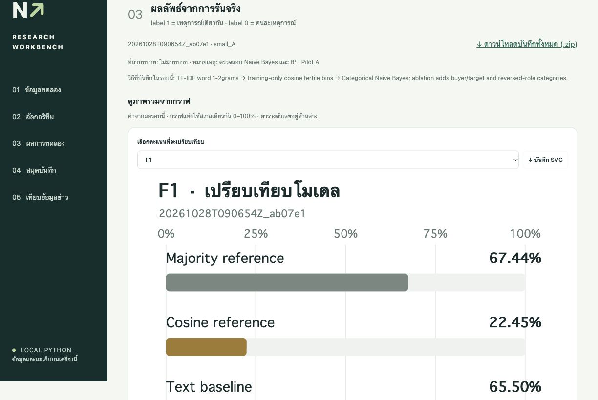

# Company News NLP Workbench

เว็บสำหรับทดลอง NLP กับ **คู่ข้อความจากข่าวบริษัท** นำเข้า Excel/CSV แก้โค้ด Python รันเปรียบเทียบโมเดล และเก็บหลักฐานของแต่ละรอบไว้ใช้ในรายงานวิจัย

โครงงานนี้กำลังศึกษาว่า **การเพิ่มข้อมูลบทบาทผู้ซื้อและบริษัทเป้าหมาย ช่วยบอกได้ไหมว่าข่าวสองชิ้นกล่าวถึงเหตุการณ์เดียวกัน** โดยใช้การทดลองเล็ก ๆ ที่ตรวจสอบและทำซ้ำได้ก่อน

> **สถานะปัจจุบัน:** รัน baseline ได้แล้ว และเตรียมโค้ด Text + roles ไว้แล้ว ส่วน buyer/target ของข้อมูลจริงยังต้องทำป้ายกำกับ จึงยังไม่มีผลที่ยืนยันว่า improvement ช่วยได้



## ถ้าเพิ่งเข้ามาใน repo นี้

1. ติดตั้งและเปิดเว็บตามขั้นตอนด้านล่าง
2. เลือก **Pilot A → โหลดข้อมูล → รันและบันทึกการทดลอง** เพื่อดูระบบทำงาน
3. อ่าน [วิธีการทดลอง](METHODS_TH.md) และ [แผนงานสำหรับทีม](docs/TEAM_HANDOFF_TH.md) ก่อนแก้โมเดล
4. อ่าน [คู่มือฉบับละเอียด](README_TH.md) เมื่อต้องการนำเข้าไฟล์หรือเขียนโค้ดเอง

## ติดตั้งบนเครื่องใหม่

ต้องมี **Python 3.12**, Git และอินเทอร์เน็ตสำหรับติดตั้ง dependencies ครั้งแรก การทดลองตั้งต้นใช้ CPU และไม่ต้องมี API key

```sh
git clone https://github.com/Micosz/company-news-nlp-workbench.git
cd company-news-nlp-workbench
```

Repo เป็น public จึงอ่านและ clone ไปทดลองได้ทันที หากต้องการ push เข้า repo โดยตรง เจ้าของ repo ต้องเพิ่มสิทธิ์ collaborator ก่อน และไม่ใส่ token ลงไฟล์ของโครงการ

### macOS / Linux

```sh
python3.12 -m venv .venv
.venv/bin/python -m pip install -r requirements.txt
.venv/bin/python server.py --open-browser
```

หากคำสั่ง `python3` ของเครื่องเป็น 3.12 อยู่แล้ว ใช้ `python3` แทน `python3.12` ได้ หลังติดตั้งบน macOS สามารถดับเบิลคลิก `Start_Workbench.command` ในครั้งถัดไปได้

### Windows PowerShell

```powershell
py -3.12 -m venv .venv
.venv\Scripts\python.exe -m pip install -r requirements.txt
.venv\Scripts\python.exe server.py --open-browser
```

เว็บเปิดที่ **http://127.0.0.1:8765** และต้องเปิด Terminal ค้างไว้ หยุดด้วย `Ctrl+C` ขณะไม่มีการทดลองรันอยู่ ระบบได้รับการตรวจบน macOS นี้ ส่วน Windows มีคำสั่งติดตั้งให้ แต่ยังไม่ได้ทดสอบครบทุกฟังก์ชัน

## เว็บทำอะไรได้แล้ว

- โหลดชุด Pilot A/B ที่แนบมา หรือนำเข้า `.xlsx` / `.csv` แล้วเลือกคอลัมน์
- ตรวจป้ายกำกับ คู่ซ้ำ และการรั่วข้าม train/test ของเอกสาร กลุ่ม และข้อความตรงกัน
- แก้ Python ในเว็บ นำเข้าไฟล์ `.py` หรือดาวน์โหลดโค้ดออกไป
- รัน Majority reference, Cosine reference, Text baseline และ Text + roles เมื่อมีข้อมูลบทบาท
- ดู Precision, Recall, F1, Macro F1 และ TP/FP/FN/TN พร้อมคู่ที่ทำนายผิด
- เก็บข้อมูล โค้ด การตั้งค่า seed พารามิเตอร์ที่เรียนรู้ เวอร์ชัน dependencies และผลทำนายแยกต่อรอบ
- ดาวน์โหลดหลักฐานของแต่ละรอบเป็น ZIP

**โค้ด Python ที่วางจะรันด้วยสิทธิ์ผู้ใช้บนเครื่องจริง** ใช้เฉพาะโค้ดที่ทีมตรวจแล้ว ตัวเว็บเป็นเครื่องมือสำหรับคนเดียวบน localhost ไม่ควรนำขึ้นโฮสต์สาธารณะตามโค้ดปัจจุบัน

## อัลกอริทึมที่ทดลอง

```text
คู่ข้อความจากข่าว A / B
        ↓
HTML unescape → Unicode NFC → whitespace normalization
        ↓
TF-IDF word 1–2 grams (fit เฉพาะ train)
        ↓
Cosine similarity
        ├── Text baseline: cosine → Logistic Regression
        └── Text + roles: cosine + buyer/target compatibility → Logistic Regression
        ↓
วัดกับ labels ของ test ที่เก็บไว้ภายนอกฟังก์ชันโมเดล
```

การเปรียบเทียบส่วนเพิ่มจะใช้ **Text baseline vs Text + roles** บนข้อมูล split ตัวจำแนก และ hyperparameters เดียวกัน มี 7 role features เช่น buyer_match, target_match, mismatch, reversed_roles และตัวบอกว่ามีข้อมูลครบหรือไม่ อ่านนิยามและสูตรวัดผลใน [METHODS_TH.md](METHODS_TH.md)

CohTP เป็นงานที่ใช้ประกอบการตั้งโจทย์ โค้ดใน repo นี้เป็น baseline/ablation ที่เราเขียนเอง ยังไม่มีการทำ NLI temporal graph, GNN หรือวัดผล clustering แบบเต็มระบบ

## ข้อมูลที่แนบมา

| ชุด | เนื้อหา | การแบ่ง |
|---|---|---|
| Pilot A | 42 ข่าว / 4 focal acquisition events / 424 คู่ | train AMD 253 คู่ → test HP 171 คู่ |
| Pilot B | ข้อมูลเดียวกัน สลับทิศ | train HP 171 คู่ → test AMD 253 คู่ |
| Full ECB+ (optional) | 982 ข่าวหลายโดเมน / 104,840 คู่ที่เตรียมไว้ | custom topic split; ใช้ package แยก |

Pilot พร้อมใช้หลัง clone; ข้อมูล full และผลรันดิบไม่ได้อยู่ใน Git วิธีเตรียม full และที่มาของข้อมูลอยู่ใน [DATA_SOURCES_TH.md](docs/DATA_SOURCES_TH.md)

Excel เริ่มต้นอยู่ที่ [data/pilot_fold_A_roles_blank.xlsx](data/pilot_fold_A_roles_blank.xlsx) หรือดาวน์โหลดจากเว็บ ช่อง buyer/target ยังว่างโดยตั้งใจ

คอลัมน์บังคับ: `pair_id`, `text_a`, `text_b`, `label`, `split`, `doc_a`, `doc_b`, `group_id` — `label=1` คือเหตุการณ์เดียวกัน และ `label=0` คือคนละเหตุการณ์ รายละเอียด mapping และ roles อยู่ใน [คู่มือ](README_TH.md#นำเข้า-excel--csv)

## ผลเริ่มต้นที่มีหลักฐานแล้ว

| การทดลอง | Text baseline F1 | Macro F1 | หมายเหตุ |
|---|---:|---:|---|
| Pilot A | 0.6486 | 0.4993 | train AMD → test HP |
| Pilot B | 0.6291 | 0.5401 | train HP → test AMD |

ค่าเหล่านี้ยืนยันว่า pipeline รันและวัดผลได้ **ยังไม่ใช่ผล improvement** และ positive-class F1 ยังต่ำกว่าการทาย class ที่พบบ่อยทุกแถวในทั้งสอง pilot คู่ที่มาจากเพียง 4 เหตุการณ์ไม่ใช่ตัวอย่างอิสระจำนวนมาก

สรุปหลักฐานที่ตัดข้อความข่าวและ path ส่วนตัวออกอยู่ใน [docs/INITIAL_RESULTS.json](docs/INITIAL_RESULTS.json) ผลดิบเดิมบนเครื่องยังอยู่ใน `runs/` และไม่ถูก commit

## รันจาก Terminal และตรวจโค้ด

```sh
.venv/bin/python run_experiment.py --dataset small_A
.venv/bin/python run_experiment.py --dataset small_B
.venv/bin/python -m unittest test_workbench -v
```

ใช้ Python executable แบบ Windows ตามหัวข้อติดตั้งได้เช่นกัน ผลแต่ละรอบอยู่ใน `runs/<run_id>/` รวม `manifest.json`, `algorithm.py`, `dataset.csv`, `metrics.json`, `predictions.csv`, `errors.csv` และ `report.md`

GitHub Actions จะตรวจ Python syntax, JavaScript syntax และ unit tests บน Ubuntu/Python 3.12 เมื่อ push หรือเปิด PR โดยไม่ทำการทดลอง full หรือส่งข้อมูลไปบริการโมเดลภายนอก

## โครงสร้างหลัก

```text
algorithms/pair_experiment.py   โมเดลตั้งต้นและ role features
engine.py                      โหลดข้อมูล / ตรวจ split / เตรียมบันทึก
worker.py                      รันโค้ด / วัดผล / export
server.py                      เว็บบน localhost และงานเบื้องหลัง
static/                        หน้าเว็บภาษาไทย
run_experiment.py              รันการทดลองจาก Terminal
data/pilot/                    pilot และ licenses ต้นฉบับ
docs/                          แผนทีม ที่มาข้อมูล และผลเริ่มต้น
scripts/prepare_datasets.py     สร้าง dataset จากไฟล์ต้นทางที่ดาวน์โหลดแล้ว
```

## ข้อจำกัดที่ต้องจำก่อนเขียนรายงาน

- Same deal กับ same event ต่างกัน: ข่าวประกาศซื้อกับข่าวปิดดีลอาจเป็นคนละเหตุการณ์
- ใช้ gold event contexts เป็น input; ยังไม่ได้วัดขั้นดึง event mentions อัตโนมัติ
- บทบาทที่คนใส่ต้องเรียกว่า **manual/oracle-role experiment** ไม่ใช่ผล extractor อัตโนมัติ
- Gold same-event ต้องเป็นอิสระจาก buyer/target agreement
- คะแนนเป็นระดับคู่ข้อความ เปรียบเทียบตรง ๆ กับ CoNLL clustering metrics ของ CohTP ไม่ได้
- Pilot เป็น subset ของ full test; ถ้าใช้ pilot ปรับโมเดลแล้ว ห้ามเรียก full test ชุดเดิมว่า untouched
- การดู test errors เพื่อปรับรอบถัดไปทำให้ test เป็นข้อมูลพัฒนา ต้องเตรียม held-out ใหม่ก่อนข้อสรุปสุดท้าย

## เอกสารและการทำงานร่วมกัน

- [คู่มือใช้งานเต็ม](README_TH.md)
- [วิธีการทดลองและการวัดผล](METHODS_TH.md)
- [แผนเริ่มงานสำหรับทีม](docs/TEAM_HANDOFF_TH.md)
- [ที่มาข้อมูลและการเตรียม full](docs/DATA_SOURCES_TH.md)
- [แนวทางส่งงานและ PR](CONTRIBUTING.md)
- [สถานะและการเปลี่ยนแปลง](CHANGELOG.md)
- [เงื่อนไขข้อมูลภายนอก](THIRD_PARTY_NOTICES.md)

Repo นี้ใช้ร่วมกันในทีมและยังไม่ได้กำหนด open-source license สำหรับโค้ดโครงการ ส่วน annotation และข้อความข่าวมีสิทธิ์ของเจ้าของแหล่งข้อมูลแยกกันตามเอกสารต้นฉบับ
